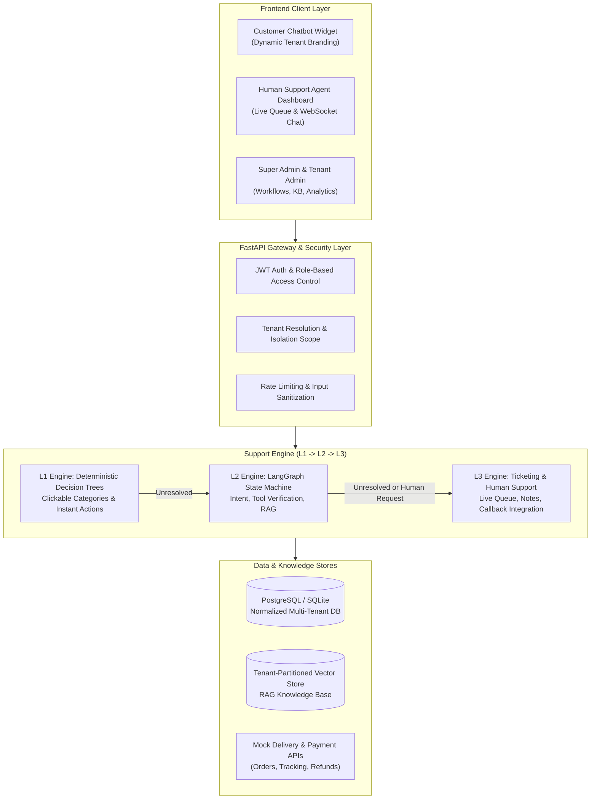
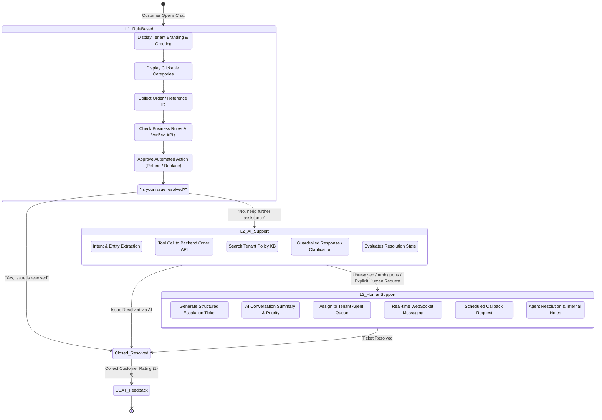

# Multi-Tenant AI Customer Support Platform — System Architecture & Roadmap

## 1. System Architecture Overview

The platform is designed as an enterprise-grade, multi-tenant customer support ecosystem inspired by the high-volume support architectures of Zomato, Swiggy, Zepto, and Rapido. It automates support through a 3-tier escalation funnel while strictly isolating tenant data, business policies, and knowledge bases.



---

## 2. Multi-Tenant Isolation Model

The platform hosts five initial production tenants:
1. **Customer A (FreshCart Quick)**: Grocery & quick commerce (Zepto/Blinkit model: missing item, damaged goods, delivery partner delayed).
2. **Customer B (BiteRush Food)**: Food delivery (Zomato/Swiggy model: wrong dish, spilled order, restaurant preparation delay).
3. **Customer C (SwiftRide Cabs)**: Ride-hailing (Rapido/Uber model: driver delay, route dispute, left item in cab).
4. **Customer D (StyleNova Retail)**: Fashion e-commerce (size exchange, return pickup, refund tracking).
5. **Customer E (VoltExpress Logistics)**: Hyperlocal & parcel logistics (package tracking, address update, delivery rescheduling).

### Isolation Invariants:
- **Tenant Identification**: Extracted from subdomain, API header (`X-Tenant-ID`), or JWT claims.
- **Database Scope**: Every customer-facing table carries `tenant_id` with foreign key referencing `tenants.id`.
- **Backend Enforced**: All queries in repositories and services automatically apply `WHERE tenant_id = :tenant_id`. No client can request cross-tenant data.
- **Vector Isolation**: Knowledge document embeddings are indexed in tenant-isolated collections / metadata partitions (`tenant_id == doc.tenant_id`).

---

## 3. Support Level Progression



---

## 4. Complete Database Schema (19 Core Entities)

1. `tenants`: Primary customer accounts (ID, code, name, domain, status, created_at).
2. `tenant_configs`: Branding colors, welcome greeting, support phone, business hours, escalation thresholds.
3. `users`: Admin and support users with password hash and tenant association.
4. `roles_permissions`: Granular RBAC (`SUPER_ADMIN`, `TENANT_ADMIN`, `SUPPORT_AGENT`, `CUSTOMER`).
5. `customer_profiles`: End-user customer info (name, phone, email, tenant_id).
6. `issue_categories`: Hierarchical L1 categories and subcategories per tenant.
7. `l1_workflows`: Predefined deterministic rules, required fields, and automated action triggers.
8. `knowledge_documents`: FAQs, policy manuals, refund matrices per tenant.
9. `knowledge_chunks`: Text chunks with vector embeddings and tenant scope.
10. `conversations`: Support sessions with state tracking (`L1`, `L2`, `L3`, `RESOLVED`, `CLOSED`).
11. `messages`: Chat message history (role: `system`, `user`, `assistant`, `agent`, metadata).
12. `conversation_states`: LangGraph / state machine context snapshot.
13. `escalation_records`: Escalation logs with trigger reason, source level, target level, timestamp.
14. `support_tickets`: L3 ticket queue with unique ticket ID, priority, status, and AI summary.
15. `support_agents`: Agent metadata, department, active ticket load, online status.
16. `ticket_assignments`: Audit log of agent allocations.
17. `ticket_notes`: Internal agent-only collaboration notes.
18. `call_requests`: Scheduled callback requests with telephony status and agent call notes.
19. `feedback_ratings`: Post-resolution CSAT ratings (1-5 stars) and comments.
20. `audit_logs`: Tenant-aware audit trail for security and regulatory compliance.

---

## 5. Project Folder Structure

```
├── backend/
│   ├── alembic/                      # Database migration scripts
│   ├── app/
│   │   ├── api/
│   │   │   ├── deps.py               # Tenant injection, JWT validation, DB session
│   │   │   └── v1/
│   │   │       ├── api.py            # Master API router
│   │   │       ├── auth.py           # Login, registration, token refresh
│   │   │       ├── tenants.py        # Tenant provisioning & config
│   │   │       ├── chat.py           # Chat sessions & messaging
│   │   │       ├── l1_rules.py       # L1 categories & deterministic rules
│   │   │       ├── l2_ai.py          # L2 natural language chat & LangGraph
│   │   │       ├── l3_tickets.py     # L3 tickets, agent actions, notes
│   │   │       ├── callback.py       # Call / callback scheduling
│   │   │       ├── knowledge.py      # Knowledge documents & RAG search
│   │   │       ├── analytics.py      # Real-time metrics computed from DB
│   │   │       └── websocket.py      # Live WebSocket for agent-customer chat
│   │   ├── core/
│   │   │   ├── config.py             # App settings (Pydantic Settings)
│   │   │   ├── security.py           # Passwords, JWT, permissions
│   │   │   └── database.py           # SQLAlchemy async engine & Base
│   │   ├── models/                   # 19 SQLAlchemy ORM models
│   │   ├── schemas/                  # Pydantic request/response schemas
│   │   ├── services/
│   │   │   ├── tenant_service.py     # Tenant operations
│   │   │   ├── auth_service.py       # RBAC & authentication
│   │   │   ├── l1_engine.py          # Deterministic decision trees
│   │   │   ├── l2_engine.py          # LangGraph conversational state machine
│   │   │   ├── rag_engine.py         # Vector similarity search & citations
│   │   │   ├── l3_service.py         # Tickets, assignments, callbacks
│   │   │   ├── analytics_service.py  # True database-computed metrics
│   │   │   └── mock_external_api.py  # Order lookup, refunds, delivery status
│   │   └── seed/
│   │       ├── seed_data.py          # Auto-seeder for all 5 customers
│   │       └── tenant_seeds/         # JSON seed definitions for Customers A-E
│   ├── tests/                        # Comprehensive test suite
│   ├── Dockerfile
│   ├── docker-compose.yml
│   ├── requirements.txt
│   └── main.py                       # FastAPI entrypoint
├── frontend/
│   ├── public/
│   ├── src/
│   │   ├── components/
│   │   │   ├── chatbot/              # Customer Chatbot (L1/L2/L3 widget)
│   │   │   ├── agent/                # Human Agent Dashboard & Live Chat
│   │   │   ├── admin/                # Superadmin & Tenant Admin Portal
│   │   │   └── shared/               # UI components, badges, modals
│   │   ├── context/                  # AuthContext, TenantContext, ChatContext
│   │   ├── services/                 # API client & WebSocket service
│   │   ├── types/                    # TypeScript interfaces
│   │   ├── App.tsx                   # Main router & tab switcher
│   │   └── index.css                 # Tailwind CSS
│   ├── package.json
│   └── vite.config.ts
├── static/                           # Self-contained React SPA bundle for zero-install demo
└── README.md
```

---

## 6. Implementation Roadmap

- **Phase 1: Project Foundation & Multi-Tenant Core**
  - Project structure, FastAPI setup, SQLAlchemy models for all 19 entities.
  - Multi-tenant isolation engine, JWT authentication, RBAC, and seed data for Customers A, B, C, D, and E.
- **Phase 2: L1 Rule-Based Chatbot Engine**
  - Predefined category hierarchy, interactive option selection, verified mock order lookup, instant automated policy actions, resolution confirmation.
- **Phase 3: L2 Conversational AI & LangGraph State Machine**
  - Natural language dialogue, entity extraction, tenant-isolated RAG search, tool calling for orders/refunds, ambiguity clarification, auto-escalation trigger.
- **Phase 4: L3 Human Support, Ticketing & Callback Engine**
  - Escalation ticket generation with AI summary, agent dashboard, live WebSocket messaging, internal notes, status workflow, and scheduled callback system.
- **Phase 5: Admin Dashboard & Real-Time Analytics**
  - Tenant configuration manager, knowledge base manager, L1 rule editor, and analytics computed from stored conversation outcomes.
- **Phase 6: Testing, Dockerization & Verification**
  - Unit/integration tests (tenant isolation, L1->L2->L3 transitions, cross-tenant security), Docker Compose, and deployment documentation.
